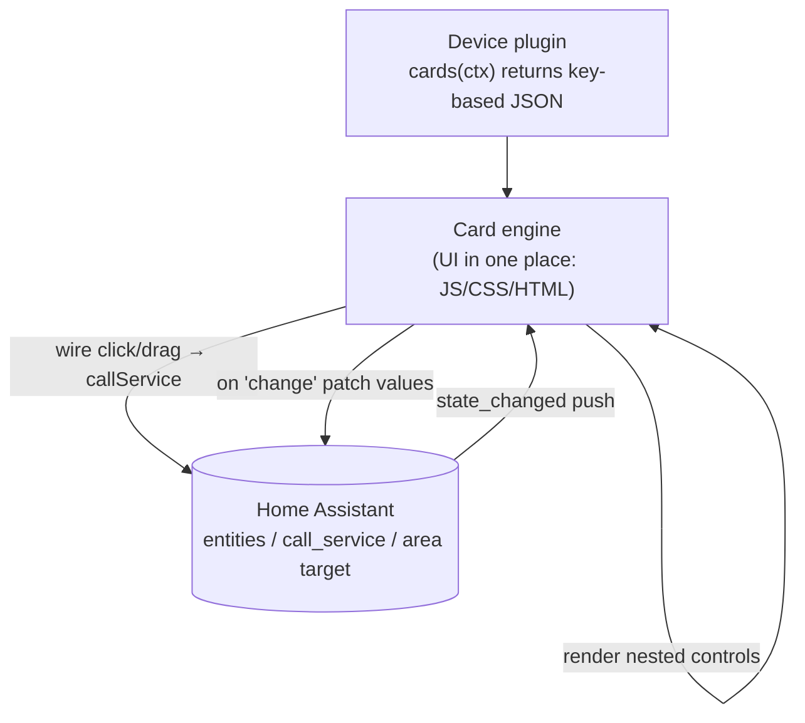

# 设备控制卡片：声明式卡片 Schema 设计方案

> 状态：草案（待拍板设计点见第 8 节）
> 适用范围：ha-3d-home 设备类插件（`kind:'device'`）在 HTML 面板中的控制卡片
> 目标：让插件只用「字段 key」声明控件，由统一的卡片引擎解析、绘制并连 Home Assistant，UI 的 JS/CSS/HTML 只在一处维护

---

## 1. 背景与目标

当前 ha3d-home 的设备类插件（`light` / `fan` / `climate` / `switch` 等 12 种）的控制方式是**在 3D 场景里点击物体**触发 `click` 里配置的 toggle，状态用 `stateText` 做标签。项目里**没有**「列出某房间里多个设备、带滑块/开关的 HTML 卡片面板」。

本方案要新增的 UI 面是一套**声明式卡片系统**：

- 每个设备类插件新增一个 `cards(ctx)` 函数，返回一份描述卡片的 **JSON**（用字段 key，而非具体实体）。
- 插件引擎 + 前端渲染引擎读取这份 JSON，**统一绘制卡片内容**，并负责把点击 / 拖动默认翻译成对 Home Assistant 的服务调用。
- 卡片的 JS、CSS、HTML **只在一处维护**（卡片引擎），插件本身不写任何 UI 代码。

### 为什么是声明式，而不是手写 12 套卡片

| 维度 | 手写每插件卡片 | 本方案（声明式） |
|---|---|---|
| UI 代码位置 | 分散在 12+ 插件 | 仅在卡片引擎一处 |
| 新增设备类型成本 | 再写一套 UI | 加一段 `cards()` JSON |
| 插件职责 | 既要懂领域又要懂实体+UI | 只懂领域（有哪些控件） |
| 与 HA 对接 | 每插件各写一次 | 引擎统一解析 key→实体、统一发命令 |

---

## 2. 总体架构



数据流：
1. 插件 `cards(ctx)` 返回 JSON（控件用字段 key 描述，含嵌套）。
2. 卡片引擎 **resolve**：遍历 JSON 收集所有 key，结合实例的 `obj.entityId` 与 `fields` 绑定，解析成具体实体 id 列表。
3. 卡片引擎 **render**：递归渲染 group / button / control。
4. 用户交互（点击 / 拖动）由引擎 **wire** 成 `HA.callService`（带节流）。
5. `HA.on('change', {entity_id})` 推送时，引擎 **patch** 受影响控件的值，不全量重渲。

> 已有的 `public/js/ha.js` 已提供 `getState` / `callService`（支持 `target` 含 `entity_id`/`area_id`）/ `on('change')`，`public/js/plugins.js` 已提供 `click`→服务映射、`isOnOf`、`baseStateText`。本方案**不新增 HA 连接基础设施**，只新增「卡片引擎」这一层。

---

## 3. 设计原则

1. **插件只声明「要哪些控件、绑哪个 key」，不碰实体 id、不写 UI。**
2. **key→实体 的解析与 HA 调用全在引擎层完成。**
3. **约定优先，显式兜底**：常见控件（开关、亮度、风速、设定温度、模式）由引擎内置约定自动对接服务；非常规需求用 `custom` 显式声明服务调用。
4. **属性边界从实体 attributes 动态取**（如 `min_temp`/`max_temp`、色温范围），不在 JSON 里硬编码。
5. **向后兼容**：`cards()` 是可选方法；没有它的插件，引擎用现有 `click`+`stateText`+`fields` 自动兜底出一张默认卡。

---

## 4. 插件侧契约：`cards(ctx)`

`cards(ctx)` 是 `PluginEngine.register({...})` 里的一个**可选**函数，签名与 `model3d(ctx)` 对齐：

- 入参 `ctx`：复用现有上下文（`obj` 含 `entityId` 与 `fields` 的 key 值、`style`、`options`、`getState` 等），让插件可按**造型 / 选项**分支（例如灯支持颜色时才显示颜色控件）。
- 返回：一份**卡片描述 JSON**（结构见第 5 节），控件里只引用**字段 key**，不出现具体实体 id。
- 可以是同步值，也可 `async` 返回。

插件不需要知道也不关心：具体实体是什么、卡片长什么样、点击后怎么调 HA——这些都由引擎处理。

---

## 5. 卡片 JSON Schema 规范

### 5.1 顶层结构

一张卡是一个节点对象，最外层通常是一个 `group`（容器），内部包含若干控件或嵌套 `group`。

```json
{
  "type": "group",
  "title": "{{friendly}}",
  "children": [ /* 控件或嵌套 group */ ]
}
```

### 5.2 控件类型

| type | 含义 | 关键字段 |
|---|---|---|
| `toggle` | 开 / 关按钮 | `key`、`service?`（默认按 domain 取 toggle/turn_on，复用现有 click 映射） |
| `button` | 一次性动作按钮（无状态回填） | `key` 或 `service`（无 key 的自定义动作） |
| `range` | 滑块（亮度 / 温度 / 风速等连续值） | `key`、`attr`、`domain`、`service`、`min`、`max`、`step`、`scale?`、`label` |
| `select` | 下拉单选（模式 / 预设等离散值） | `key`、`attr`、`domain`、`service`、`options`、`label` |
| `group` | 容器，可嵌套 | `title?`、`children` |
| `custom` | 显式声明一次 HA 服务调用（见 5.6） | `service`、`target`、`data` |

### 5.3 嵌套与分组

`group` 的 `children` 可以是任意控件，也可是另一个 `group`，形成**任意深度的嵌套**。渲染引擎用递归处理。这满足「单个实体按钮 / 一组按钮集合 / 自定义按钮组（有嵌套关系）」三种形态。

### 5.4 key 解析规则

控件里的 `key` 由引擎解析为实体 id：

- **主实体**：`key` 取保留值（建议 `"entity"`，或省略 / `null`），引擎取 `obj.entityId`。
- **扩展实体**：`key` 取插件 `fields` 里声明的 key，引擎取 `obj[key]`（即绑定的 `'sensor.xxx'` 等）。
- **裸实体 id**：允许直接写 `"light.kitchen"`（用于无 key 的自定义动作，见 5.6）。

引擎在渲染前**遍历整棵 JSON** 收集所有 key → 实体 id，用于发命令与精准订阅 `HA.on('change')`。

### 5.5 属性边界与值映射

- `min` / `max` 支持两种写法：
  - 字面量：`0` / `255` / `30`。
  - 属性引用：`"attr:min_temp"` / `"attr:max_color_temp_kelvin"`——引擎从对应实体的 `attributes` 读取实际边界（因设备而异）。
- `scale`：滑块**显示值**与**服务属性值**的换算。例如灯的 `brightness` 在 HA 是 0–255，但 UI 想显示 0–100%，则 `max:255, scale:100`，引擎在发命令时换算（`service_value = display_value / scale * max`）。
- `options`（select）：同样支持字面量数组或 `"attr:hvac_modes"` 从 attributes 取可选项。

### 5.6 自定义动作（无 key 的逻辑）

满足「无字段 key、但要实现点击 / 改变逻辑」的场景。推荐形态：**JSON 直接声明一次 HA 服务调用**，不写 JS。

```json
{
  "type": "button",
  "label": "观影模式",
  "service": { "domain": "scene", "service": "turn_on", "target": { "entity_id": ["scene.movie"] } }
}
```

约定：
- 引擎收到这类控件，交互时直接 `HA.callService(domain, service, { target, ...data })`。
- 真正无法用单次服务表达的逻辑（带条件判断等）才退回插件函数——属于少数逃生舱，会轻微突破「卡片代码全在一处」，非常规用法。

### 5.7 模板变量

JSON 字符串字段支持少量引擎注入变量，例如 `{{friendly}}` 注入实体 `friendly_name`。引擎在渲染前做替换。

---

## 6. 引擎侧职责（卡片引擎）

卡片引擎是**唯一新增的 UI 层**，包含四块：

### 6.1 Resolve（解析 key→实体）
- 递归遍历卡片 JSON，收集所有 `key` 与裸 `entity_id`。
- 主实体 key → `obj.entityId`；field key → `obj[key]`。
- 产出「控件 → 实体 id」映射表，供 wire 与 subscribe 使用。

### 6.2 Render（递归渲染）
- 单一套 DOM 模板 + CSS，处理 `group` / `toggle` / `button` / `range` / `select` / `custom`。
- 从 `HA.getState(eid)` 读初始值填入控件（range 用 `scale` 换算显示值，select 用 `attr:` 取可选项）。

### 6.3 Wire（交互→HA 调用）
- `toggle` / `button`：点击 → 调服务（约定表或 `custom` 声明）。
- `range`：拖动 → **节流**后调服务（避免每像素一次 `callService`）。
- **内置服务约定表**（建议直接复用 `plugins.js` 现有 click 映射）：
  - `light`：`toggle`→`toggle`，`range.attr=brightness`→`turn_on{brightness}`，`color_temp_kelvin`→`turn_on{color_temp_kelvin}`
  - `fan`：`toggle`→`toggle`，`range.attr=percentage`→`set_percentage`
  - `climate`：`toggle`→`turn_on/turn_off`，`range.attr=temperature`→`set_temperature`，`select.attr=hvac_mode`→`set_hvac_mode`
  - `switch` / `cover`：`toggle`→`toggle`
- 其余一律用 `custom` 显式声明。

### 6.4 Subscribe / Live patch
- 用 resolve 阶段得到的实体 id 列表，订阅 `HA.on('change', {entity_id})`。
- 状态变化时**只 patch 受影响的控件**（更新滑块位置 / 开关态 / 文案），不全量重渲。

---

## 7. 与现有插件系统的关系

- **`cards()` 是可选方法，不破坏现有 `click` / `model3d` / `stateText`**：3D 场景内的点击控制保持原样，卡片是并行的 HTML 面板面。
- **默认卡兜底**：插件若未提供 `cards()`，引擎可用现有 `click`（决定有没有开关）+ `stateText`（标签文案）+ `fields`（额外读数）自动生成一张最朴素的卡。这样 12 个插件无需改动即拥有 baseline 卡片。
- **复用已有能力**：`HA.getState / callService / on('change')`、`PluginEngine` 的 `click` 映射 / `isOnOf` / `baseStateText`、现有 `OPT_TYPES` 递归 schema 渲染范式。

---

## 8. 待拍板设计点（实现前需确认）

1. **主实体 key 约定**：`"entity"` / `null` / 省略，三选一。
2. **内置服务约定表**：列清各 domain 每个控件类型默认调哪个服务（建议直接复用 `plugins.js` 现有 click 映射）。
3. **自定义动作形态**：确认「无 key 就声明一次 HA 服务调用」，而非允许插件塞 JS 函数（决定「卡片代码能否真全在一处」）。
4. **值映射规则**：滑块显示值 ↔ 属性值的换算用 `scale` 字段声明，还是按 domain 自动约定。
5. **attr 边界取值**：滑块 `min/max` 默认优先读实体 attributes，缺省再回退 JSON 字面量（已默认此行为，确认即可）。
6. **`cards(ctx)` 入参**：确认给 `ctx`（含 `obj` / `style` / `options`），允许插件按造型 / 选项分支。

---

## 9. 工作量估算

相比「手写灯/风扇/空调多套卡片（约 900–1500 行 JS + 约 200 行 CSS）」，本方案拆成：

| 模块 | 新增代码 | 难度 |
|---|---|---|
| 卡片引擎（resolve / render / wire / subscribe） | ~400–600 行 JS | 中等（智力活集中在此） |
| 卡片样式 | ~200 行 CSS | 轻 |
| 每插件 `cards()` JSON | ~20–60 行 / 个 | 轻 |
| 默认卡兜底（无 `cards()` 的插件） | ~80–120 行 | 轻 |

总量更少、可维护性远超手写，且新增设备类型成本趋近于零。基础设施（HA 连接 / 实时 / 命令）已免。

---

## 10. 实施路线

1. **定 JSON schema**（含第 8 节 6 个设计点）→ 落到本文档。
2. **写卡片引擎骨架**：resolve / render / wire / subscribe 四块 + 一套 CSS。
3. **给 `light` / `climate` / `fan` 写 `cards()`** 验证闭环（先单设备卡片跑通，房间触发后接）。
4. **默认卡兜底**：无 `cards()` 的插件自动出 baseline 卡。
5. **接入房间触发**：房间 → 实体列表 → 批量渲染卡片（数据源先用本地 room→entity 配置，后续可选接 HA area registry）。

---

## 附录 A：light 插件 `cards()` 示例 JSON

```json
{
  "type": "group",
  "title": "{{friendly}}",
  "children": [
    { "type": "toggle", "key": "entity" },
    { "type": "range", "key": "entity", "attr": "brightness",
      "domain": "light", "service": "turn_on",
      "min": 0, "max": 255, "scale": 100, "step": 1, "label": "亮度" },
    { "type": "range", "key": "entity", "attr": "color_temp_kelvin",
      "domain": "light", "service": "turn_on",
      "min": "attr:min_color_temp_kelvin", "max": "attr:max_color_temp_kelvin",
      "label": "色温" }
  ]
}
```

## 附录 B：climate 插件 `cards()` 示例 JSON

```json
{
  "type": "group",
  "title": "{{friendly}}",
  "children": [
    { "type": "toggle", "key": "entity" },
    { "type": "range", "key": "entity", "attr": "temperature",
      "domain": "climate", "service": "set_temperature",
      "min": "attr:min_temp", "max": "attr:max_temp", "step": 0.5, "label": "设定温度" },
    { "type": "select", "key": "entity", "attr": "hvac_mode",
      "domain": "climate", "service": "set_hvac_mode",
      "options": "attr:hvac_modes", "label": "模式" }
  ]
}
```

## 附录 C：fan 插件 `cards()` 示例 JSON

```json
{
  "type": "group",
  "title": "{{friendly}}",
  "children": [
    { "type": "toggle", "key": "entity" },
    { "type": "range", "key": "entity", "attr": "percentage",
      "domain": "fan", "service": "set_percentage",
      "min": 0, "max": 100, "step": 1, "label": "风速" },
    { "type": "toggle", "key": "entity", "attr": "oscillating",
      "domain": "fan", "service": "oscillate", "label": "摆头" }
  ]
}
```

## 附录 D：无 key 的自定义动作示例

```json
{
  "type": "button",
  "label": "观影模式",
  "service": { "domain": "scene", "service": "turn_on", "target": { "entity_id": ["scene.movie"] } }
}
```
